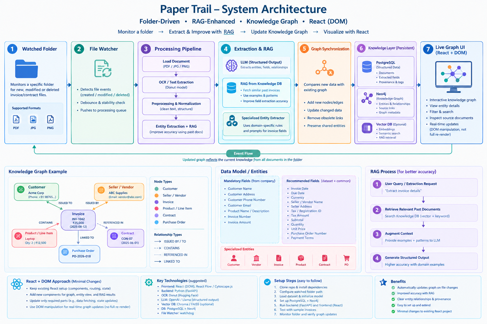

# Paper Trail — Codex Build Brief

> **Purpose:** Build Paper Trail incrementally in the existing repository. Do not replace the project wholesale. Inspect the current code first, preserve working functionality, and make small, testable changes.

## Architecture



The system watches a designated folder for new, modified, moved, or deleted invoice/document files. It extracts structured information, uses retrieval-augmented generation (RAG) with relevant verified prior records, maintains a persistent knowledge graph, and updates the existing React UI incrementally.

## Product requirements

1. **Folder-driven ingestion:** No manual upload is required for the core workflow. A configured folder is monitored continuously.
2. **File types:** Initially support PDF, JPG, and PNG. Handle incomplete writes, duplicate watcher events, retries, and startup reconciliation.
3. **Invoice extraction:** Use the `katanaml-org/invoices-donut-data-v1` Hugging Face dataset to inspect annotation labels and establish a baseline. Evaluate the compatible pretrained Donut invoice model before deciding whether fine-tuning is necessary.
4. **Required company fields:**
   - Customer name
   - Customer address
   - Customer phone number
   - Customer email
   - Product / line-item description (support multiple items)
   - Invoice number
   - Invoice amount
5. **Additional fields when present:** invoice date, due date, currency, seller/vendor name and address, tax/registration ID, subtotal, tax amount, quantity, unit price, purchase-order number, payment terms, and other fields supported by the annotation schema.
6. **Honest extraction:** Missing or unreadable values must be `null`/unknown, not invented. Distinguish customer/buyer from seller/vendor. Validate output types and numeric/currency fields.
7. **RAG:** Retrieve relevant, verified prior invoices, approved vendor aliases, extraction examples, and applicable rules. Use retrieved context to assist extraction and entity resolution. RAG is not model training; never let a prior record override explicit evidence in the current document.
8. **Specialized knowledge graph:** Represent entities as typed nodes and relationships as typed edges. Initial node types: `Customer`, `Vendor`, `Invoice`, `Product`/`LineItem`, `Contract`, `PurchaseOrder`, and `Document`.
9. **Provenance:** Preserve source document ID, file version/hash, page and evidence snippet where available, extraction method, and review status. Facts supported by multiple documents must track each supporting source.
10. **Incremental graph sync:** On a file change, compare old and new extracted facts. Add new facts, update changed facts, and remove obsolete source-supported facts only when no other source supports them. File deletion removes that source's support; do not delete shared entities still used elsewhere.
11. **React UI:** Keep the existing React DOM/application structure. Add or update only relevant components/state (graph, entity details, processing status, search results). Prefer React-managed state and targeted updates, not direct mutation of React-owned DOM. Use WebSocket or SSE for live notifications if appropriate.
12. **Persistent knowledge store:** Prefer PostgreSQL for document registry, extraction results, job status, versions, and provenance; Neo4j for graph nodes/edges; a vector index is optional and should be introduced only if useful for semantic RAG. Choose the simplest setup compatible with the current repo.
13. **Reliability:** Startup folder scan/reconciliation, idempotent jobs, content hashes, debouncing/stability checks, retries, structured logs, and preserving the last valid graph when processing fails.
14. **Security:** Validate file paths/types/sizes, avoid executing documents, keep credentials in environment variables, and do not send sensitive invoice data to external services without an explicit configuration/approval path.

## Recommended architecture and data flow

1. Configured watched folder
2. Python file watcher (`watchdog`)
3. Persistent processing queue/job registry (start with a database-backed job table if adequate)
4. File stability check, content hash, MIME/type validation
5. PDF text extraction where available; OCR/Donut pipeline for scanned/image-based invoices
6. Structured extraction and schema validation
7. RAG retrieval from verified prior records and approved examples
8. Entity resolution and fact comparison
9. PostgreSQL persistence + Neo4j graph synchronization
10. Existing React UI updated through its existing state architecture and a live event channel when appropriate

**Important design note:** The diagram is a conceptual architecture, not a mandate to install every technology immediately. Inspect the repository and reuse existing dependencies and patterns. Do not add Celery, Redis, vector DB, or extra services unless justified by the actual project needs.

## Initial entity and relationship model

### Node types

- `Document`: stable document ID, current path, content hash, version, processing status
- `Customer`: normalized name and available contact/address fields
- `Vendor`: normalized seller name, aliases and available contact/address fields
- `Invoice`: invoice number, dates, total amount, currency, tax/subtotal when present
- `LineItem` (or `Product`): description, quantity, unit price, line total
- `Contract`: contract identifier, dates and status when available
- `PurchaseOrder`: PO number, date and amount when available

### Relationship types

Use explicit direction and consistent names. Examples (confirm semantics from evidence):

- `(Vendor)-[:ISSUED]->(Invoice)`
- `(Invoice)-[:BILLED_TO]->(Customer)`
- `(Invoice)-[:CONTAINS]->(LineItem)`
- `(LineItem)-[:REFERS_TO]->(Product)` if products are modeled separately
- `(Invoice)-[:REFERENCES]->(PurchaseOrder)`
- `(Invoice)-[:GOVERNED_BY]->(Contract)` only when supported by evidence
- `(Document)-[:SUPPORTS]->(Invoice or extracted fact/entity)`
- `(Document)-[:SOURCE_OF]->(extracted fact)` if facts are represented separately

Avoid assuming that two entities are linked just because they appear in the same folder or seem semantically related. Preserve evidence for each edge.

## Suggested repository layout

Adapt this to the existing repository; do not force a migration if equivalent structure already exists.

```text
paper-trail/
├── backend/
│   ├── app/
│   │   ├── main.py
│   │   ├── config.py
│   │   ├── watcher/
│   │   ├── ingestion/
│   │   ├── extraction/
│   │   ├── rag/
│   │   ├── entities/
│   │   ├── graph/
│   │   ├── storage/
│   │   └── api/
│   ├── tests/
│   └── requirements.txt
├── frontend/                 # reuse existing React app if present
├── assets/
│   └── paper-trail-architecture.png
├── .env.example
├── docker-compose.yml        # only if useful for selected databases
└── README.md
```

## Build plan: implement in vertical slices

### Slice 0 — Repository reconnaissance (do this first)

- Inspect folders, current stack, entry points, dependencies, existing tests, and current git status.
- Read the current README and project documentation.
- Report what already exists and map the proposed architecture onto the current code.
- Do not overwrite or remove existing files.
- Present a short implementation plan and identify blockers before large changes.

### Slice 1 — Reliable folder ingestion

- Add configurable `WATCH_FOLDER`.
- Monitor create/modify/delete events.
- Debounce duplicate events and wait for file writes to settle.
- Compute SHA-256 and maintain a stable document identity separately from the path.
- Add startup reconciliation so events missed while the app was stopped are recovered.
- Persist processing states and errors.
- Add tests for repeated events, modifications, deletions, renames/moves where detectable, and startup scan.

### Slice 2 — Extraction baseline

- Inspect dataset cards, splits, labels and example records before writing model-specific code.
- Keep training/evaluation data separate from live watched-folder inputs.
- Implement a typed JSON schema for required and optional fields.
- Establish a baseline on a small representative evaluation set; report metrics and failure cases.
- Add evidence/provenance and missing-value handling.
- Do not fine-tune a model unless the baseline and available labels justify it.

### Slice 3 — Persistence and knowledge graph

- Implement document registry, extracted records, source provenance, and job status.
- Create typed graph nodes/edges and idempotent upserts.
- Store which documents support each fact/relationship.
- Reprocess a changed file and reconcile only its old/new facts.
- Test shared entities, changed values, deletion, failed processing, and duplicate events.

### Slice 4 — RAG and entity resolution

- Start with retrieval of verified structured examples and vendor aliases.
- Add semantic vector retrieval only if needed; combine with metadata/keyword filters.
- Exclude failed, unreviewed, or low-quality extractions from trusted examples by default.
- Make the LLM return structured data and evidence, not unrestricted graph-write instructions.
- Evaluate extraction quality with RAG versus without RAG on the same held-out set.

### Slice 5 — Existing React UI

- Reuse existing routing, state management, styles and build tooling.
- Add graph view, entity details, source evidence, processing status and search as incremental components.
- Update state for only the affected graph elements when backend events arrive.
- Avoid full-page reloads and avoid direct DOM mutation of React-owned nodes.
- Add loading/error/retry states and basic tests.

### Slice 6 — Setup and documentation

- Provide `.env.example`, exact setup/run commands, sample documents or synthetic test fixtures, and troubleshooting.
- Add a startup health check and explain how to run the watcher and UI.
- Document any external services, costs, data handling, and limitations.
- Ensure the project can be run locally by a new teammate from a clean checkout.

## Acceptance criteria

- Dropping a valid invoice into the watched folder automatically triggers processing without a manual upload.
- The required fields are returned in a stable JSON shape; unavailable fields are null.
- Repeated watcher events do not create duplicate documents, nodes, or edges.
- Modifying a file updates changed facts and preserves unrelated graph data.
- Deleting a file removes only that source's contribution; shared facts remain if other sources support them.
- RAG retrieves relevant verified prior examples and can be evaluated against a no-RAG baseline.
- Graph edges are typed, evidence-backed, and traceable to source documents.
- The React UI shows processing status and updates relevant graph state without a page reload.
- Failures are logged, retryable, and do not destroy the last valid graph.
- Setup instructions work on a clean local environment.

## Codex working rules

- Start by inspecting the repository; do not assume the current stack or file layout.
- Make small changes and run relevant tests after each slice.
- Explain important design decisions and list files changed.
- Never claim a test passed unless it was actually run.
- Do not commit, push, delete files, or perform destructive migrations unless explicitly asked.
- If a dependency/service adds substantial setup complexity, propose a simpler alternative first.
- Keep `.env`, credentials, real customer data, and sensitive invoice documents out of version control.
- Ask before making a decision that would materially change the architecture; otherwise choose a minimal, reversible default and document it.

## First Codex task

**Only perform Slice 0 initially.** Inspect the current repository and report:
1. Existing architecture and technologies
2. What can be reused
3. Gaps against this brief
4. A file-by-file plan for Slice 1
5. Exact commands to run tests and the app

Do not begin a broad rewrite. After the report, implement the smallest useful next slice.
