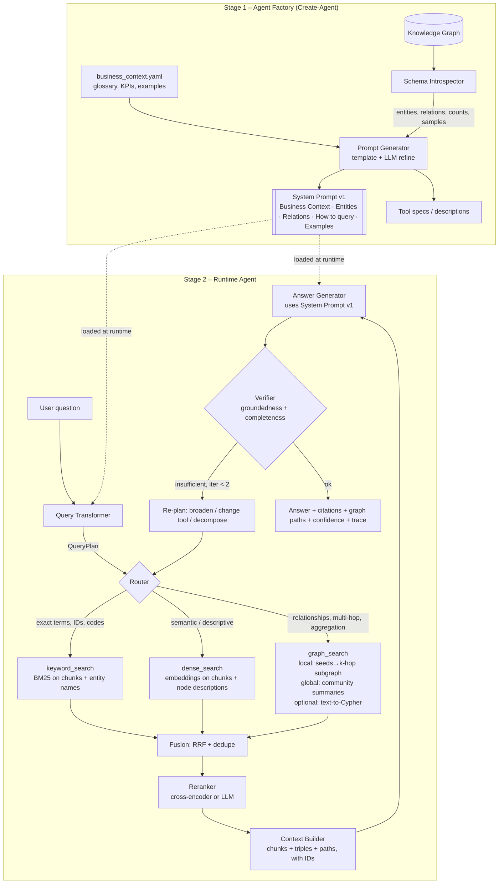

# CODEX PROMPT — Business Q&A Agent over a Knowledge Graph (GraphRAG + DenseRAG + Keyword)

> Paste everything below the line into Codex (or save as `AGENTS.md` in the repo root).
> Build it milestone by milestone. Run the tests after each milestone and do not move on until they pass.

---

## 1. Goal

Build a Python project, `kg-agent`, that answers **business questions** over a **knowledge graph (KG) extracted from documents**.

It has two stages:

1. **Agent Factory ("Create-Agent")** reads the KG schema and a business-context file, then **generates the agent's system prompt** as
   `SystemPrompt = f(Entities, Relations, BusinessContext, Examples)`.
2. **Runtime Agent** takes a user question, **transforms the query**, retrieves evidence with **three tools (Keyword, Dense, Graph)**, fuses and reranks it, and returns a **grounded, cited answer**.

It must also support `--mode dense | graph | keyword | hybrid | agent`, so the retrieval strategies can be compared in an evaluation.

## 2. Hard constraints

- Python 3.11+. Use `pydantic` v2 for all data contracts. Use type hints everywhere.
- **Free models only.** One OpenAI-compatible client (`openai` SDK) with a switchable base URL:
  - `LLM_PROVIDER=ollama` → `http://localhost:11434/v1`, default `LLM_MODEL=qwen2.5:7b-instruct`
  - `LLM_PROVIDER=openrouter` → `https://openrouter.ai/api/v1`, `LLM_MODEL` read from env (use a `:free` model; do not hardcode, since IDs change), key from `OPENROUTER_API_KEY`
  - Embeddings: `EMBED_MODEL=nomic-embed-text` via Ollama by default. Optional fallback is `sentence-transformers` (`BAAI/bge-small-en-v1.5`) when Ollama is unavailable.
- Everything is configured through `.env` and `config.yaml`. No secrets in code.
- Strip `<think>...</think>` blocks from model output (Qwen3 emits them).
- Small local models are weak at native tool calling. So the default runtime is **plan-then-execute**: the LLM produces a JSON `QueryPlan`, and **code** executes the tools. The `agent` mode adds a bounded loop of at most 2 refinement iterations.
- Every LLM call that expects JSON must use JSON mode or schema-constrained output, plus a `repair_json()` fallback and 1 retry.
- The graph is **read-only** at query time. Any generated Cypher must pass a validator that rejects write keywords (`CREATE, MERGE, DELETE, SET, REMOVE, DROP, CALL dbms`) and enforces `LIMIT`.
- Must run fully offline except for the optional OpenRouter provider.

## 3. Input data contracts (the KG already exists)

Support two backends behind one `KnowledgeGraphStore` interface:

1. **File backend (default, build first):** a folder `data/kg/` containing
   - `nodes.jsonl`: `{"id","type","name","aliases":[],"description","properties":{},"chunk_ids":[]}`
   - `edges.jsonl`: `{"id","source","target","type","properties":{},"chunk_ids":[]}`
   - `chunks.jsonl`: `{"id","doc_id","page","text"}`
   - Loaded into `networkx.MultiDiGraph`.
2. **Neo4j backend (build last, optional):** same logical schema; use the official `neo4j` driver. Config via env.

Interface:

```python
class KnowledgeGraphStore(Protocol):
    def schema(self) -> GraphSchema: ...                      # entity types, relation types, counts, sample values, property keys
    def get_node(self, node_id: str) -> Node: ...
    def neighbors(self, node_id: str, rel_types: list[str] | None, direction: str, limit: int) -> list[Edge]: ...
    def subgraph(self, seeds: list[str], hops: int, rel_types: list[str] | None, max_nodes: int) -> Subgraph: ...
    def find_paths(self, a: str, b: str, max_hops: int, k: int) -> list[Path]: ...
    def chunks_for(self, node_or_edge_ids: list[str]) -> list[Chunk]: ...
    def all_chunks(self) -> Iterable[Chunk]: ...
    def all_nodes(self) -> Iterable[Node]: ...
    def communities(self) -> list[Community]: ...             # for global GraphRAG
```

Also create a **small sample dataset** in `data/sample/` (about 40 nodes, 60 edges, 30 chunks in a business domain such as supplier contracts, invoices and customers). It must be enough to run the demo and the tests end to end with no external setup.

## 4. Business context file: `config/business_context.yaml`

```yaml
domain: "Supplier contracts & procurement"
audience: "Procurement managers, finance analysts"
goals: ["Answer business questions with cited evidence", "Prefer precision over guessing"]
glossary: { "MSA": "Master Service Agreement", "SLA": "Service Level Agreement" }
kpis: ["contract value", "renewal date", "penalty clauses", "supplier risk"]
answer_style: "Concise, business-friendly, numbers with units, always cite sources"
examples:
  - question: "Which suppliers have contracts expiring in Q1 2026?"
    plan_hint: "graph: Supplier -[HAS_CONTRACT]-> Contract (filter end_date); keyword on 'expiry'"
    ideal_answer: "..."
```

## 5. Architecture



### 5.1 Agent Factory

`factory/schema_introspector.py` calls `store.schema()` and returns the entity types (with descriptions, counts, 3 sample names, property keys) and the relation types (domain → range, counts, one sample triple).

`factory/prompt_generator.py` implements `generate_system_prompt(schema, business_context) -> SystemPromptArtifact`:

1. **Deterministic render** with a Jinja2 template, `templates/system_prompt.j2`, into these sections:
   - `ROLE & BUSINESS CONTEXT`
   - `ENTITIES` (type, meaning, example names, key properties)
   - `RELATIONS` (`(Supplier)-[HAS_CONTRACT]->(Contract)` with meaning)
   - `HOW TO QUERY` (decision rules for choosing keyword, dense or graph; see §5.3)
   - `ANSWERING RULES` (see §5.6)
   - `EXAMPLES` (few-shot Q → plan → answer)
2. **Optional LLM refinement** (`--refine`): ask the LLM to tighten wording and add domain-specific query tips, **without adding any entity or relation that is not in the schema**. Validate this: every type name mentioned must exist in the schema, otherwise discard the refinement and keep the deterministic version.
3. Save to `artifacts/system_prompt.v{n}.md` with a JSON sidecar (schema hash, timestamp, model). Regenerate when the schema hash changes.

CLI: `kg-agent build-agent --kg data/sample --context config/business_context.yaml [--refine]`

### 5.2 Query Transformer (the core of "how the query is transformed")

`runtime/query_transformer.py` takes `question` and optional chat history and returns a `QueryPlan`:

```python
class QueryPlan(BaseModel):
    original: str
    standalone_question: str            # coreference resolved using history, acronyms expanded via glossary
    intent: Literal["lookup","relationship","multi_hop","aggregation","comparison","summary_global","definition"]
    entities: list[LinkedEntity]        # mention, node_id|None, confidence
    sub_questions: list[SubQuestion]    # for multi_hop/comparison/aggregation; each has its own tool list
    keyword_query: str                  # terms, IDs, quoted phrases, synonyms
    dense_query: str                    # natural-language rewrite; optional HyDE passage (hypothetical answer)
    graph_query: GraphQuery | None      # seeds, rel_types, hops, direction, filters, mode: local|global|cypher
    tools: list[Literal["keyword","dense","graph"]]
    needs_clarification: str | None     # set only if the question is truly ambiguous
    rationale: str
```

Pipeline:

1. **Normalize and resolve context.** Rewrite follow-ups into standalone questions and expand glossary terms.
2. **Entity linking (code, not LLM):** extract mentions (LLM or noun-phrase extraction), then link to KG nodes. First try exact and alias match, then fuzzy match (`rapidfuzz`, threshold 85), then embedding similarity over node name + description. Keep the top-3 candidates with scores; if the top candidate is below 0.6, leave it unlinked.
3. **Intent classification and tool routing** (LLM with the generated system prompt plus a code-level sanity override):
   - Relationship, multi-hop, "who is connected to", aggregation, or "all X that have Y" → `graph` (+ `dense` for supporting text)
   - Descriptive, "what does the policy say about…", "explain" → `dense` (+ `keyword`)
   - Exact IDs, codes, clause numbers, names in quotes → `keyword` first
   - Broad "summarize / overall trends / main themes" → `graph` in **global** mode (community summaries)
   - When unsure → run all three (hybrid)
4. **Decomposition.** For multi-hop or comparison questions, split into ordered sub-questions; later sub-questions may reference earlier answers.
5. **Per-retriever rewrite.** The keyword query is terms and synonyms, the dense query is a natural-language statement (optionally HyDE), and the graph query is structured (seeds, relation types, hops).

### 5.3 Retrieval tools (`runtime/tools/`)

Each tool returns `list[Evidence]`:

```python
class Evidence(BaseModel):
    id: str; source_tool: str; kind: Literal["chunk","triple","path","community_summary"]
    text: str; score: float; doc_id: str | None; page: int | None
    node_ids: list[str] = []; edge_ids: list[str] = []
```

- **`keyword_search`**: BM25 (`rank_bm25`) over chunks and over node names/aliases. Support quoted-phrase boost and exact ID match.
- **`dense_search` (DenseRAG)**: embed chunks and node descriptions into a persistent vector store (`chromadb`, or FAISS if Chroma is unavailable). Return top-k with cosine score. Optional HyDE and MMR for diversity. Index builder command: `kg-agent index`.
- **`graph_search` (GraphRAG)**:
  - **local**: take linked seed nodes, run an `h`-hop `subgraph` (default 2, limited by `max_nodes`, filtered by `rel_types`), serialize edges as readable triples (`Acme Ltd —HAS_CONTRACT→ MSA-2024 (end_date=2026-02-28)`), attach the source chunks of each edge, and also return `find_paths` between multiple seeds.
  - **global**: run community detection (Leiden via `igraph`/`leidenalg`, or `networkx` Louvain as fallback), pre-compute LLM summaries per community at index time (`kg-agent index --communities`), then retrieve the top communities by embedding similarity to the question and map-reduce over them.
  - **cypher** (Neo4j backend only, optional): LLM text-to-Cypher using the schema, passed through the read-only validator, with 1 repair retry on error.
  - Support **aggregation** (count, sum, min/max, filter by property) deterministically in code over node/edge properties so the LLM does not do arithmetic on its own.

### 5.4 Fusion, rerank, context building

- **Fusion**: Reciprocal Rank Fusion (k=60) across tool results, then dedupe by `(doc_id, chunk_id)` and merge triples with their source chunks.
- **Rerank**: cross-encoder (`BAAI/bge-reranker-base`) if installed, else a cheap LLM relevance scoring pass on the top 20. Keep the top-N (default 8).
- **Context builder**: structured sections, each item with a stable ID:
  `[C12] chunk text…`, `[T3] (A)-[REL]->(B)`, `[P1] A → B → C`, `[S2] community summary…`
  Respect a token budget (default 6k) and prioritise triples and paths for relationship questions.

### 5.5 Answer generation

Use the generated system prompt plus the context. The model must return JSON:

```json
{"answer": "...", "citations": ["C12","T3"], "reasoning_summary": "...", "confidence": 0.0-1.0, "missing_info": "..."}
```

### 5.6 Answering rules (must be in the generated system prompt)

1. Use **only** the provided evidence. If the evidence is insufficient, say so and state what is missing. Never invent entities, numbers or dates.
2. Every factual claim cites at least one evidence ID.
3. For relationship answers, show the path (A → B → C) in plain words.
4. Report numbers with units and the time period, and flag conflicts between sources instead of silently choosing one.
5. Follow the `answer_style` from the business context (concise, business-friendly).

### 5.7 Verifier and retry loop

`runtime/verifier.py`:

- **Groundedness check**: every cited ID must exist in the context, and each claim must be supported (an LLM judge returns `supported | partial | unsupported`).
- **Completeness check**: are all sub-questions answered?
- If `partial` or `unsupported`, or confidence < 0.5, and `iteration < 2`: **re-plan** (broaden the hops, add the missing tool, relax filters, decompose further) and retry. Log why.
- If still insufficient, return the best partial answer with `missing_info` set and a low confidence.

### 5.8 Response object and tracing

Return `AgentResponse { answer, citations[], evidence[], graph_paths[], confidence, query_plan, trace }`.
`trace` records every step with timings, tool inputs and outputs (truncated), and the model used. Save it as JSON in `runs/` and print a readable step log with `--verbose`. This makes the query-transformation flow demonstrable to the evaluator.

## 6. Repository layout

```
kg-agent/
├─ pyproject.toml  .env.example  config.yaml  README.md
├─ config/business_context.yaml
├─ templates/system_prompt.j2  templates/query_plan.j2  templates/answer.j2
├─ data/sample/{nodes,edges,chunks}.jsonl
├─ src/kg_agent/
│  ├─ config.py  llm.py  embeddings.py  models.py
│  ├─ kg/{base.py, file_store.py, neo4j_store.py, communities.py}
│  ├─ factory/{schema_introspector.py, prompt_generator.py}
│  ├─ runtime/{query_transformer.py, entity_linker.py, router.py, fusion.py, rerank.py,
│  │           context_builder.py, answerer.py, verifier.py, agent.py}
│  ├─ runtime/tools/{keyword.py, dense.py, graph.py}
│  ├─ eval/{dataset.yaml, run_eval.py, judges.py}
│  ├─ cli.py            # typer: build-agent, index, ask, chat, eval, serve
│  └─ api.py            # FastAPI: POST /ask, GET /schema, GET /trace/{id}
└─ tests/
```

## 7. Interfaces

- CLI: `kg-agent ask "…" --mode hybrid --verbose`, `kg-agent chat`, `kg-agent eval --modes dense,graph,hybrid,agent`
- API: `POST /ask {question, mode, history[]}` → `AgentResponse`
- A mock LLM (`FakeLLM`) must exist so that unit tests run without Ollama.

## 8. Evaluation harness (important for the evaluator demo)

- `eval/dataset.yaml`: at least 20 Q&A pairs over the sample data, tagged by intent (lookup, multi-hop, aggregation, summary), each with `gold_answer` and `gold_evidence_ids`.
- Metrics per mode (dense, graph, keyword, hybrid, agent):
  - retrieval **recall@k** against the gold evidence IDs
  - **answer correctness** (LLM judge, 0–1)
  - **faithfulness** (share of claims supported by the evidence)
  - latency and number of LLM calls
- Output a Markdown table `runs/eval_report.md` showing where GraphRAG beats DenseRAG (multi-hop and aggregation) and where Dense wins (descriptive questions).

## 9. Milestones (do them in order, run `pytest` after each)

1. **Scaffold and LLM layer**: config, `llm.py` (Ollama and OpenRouter, JSON mode, think-strip, retry), `FakeLLM`, `embeddings.py`. *Done when:* a smoke test gets a JSON reply from the fake and, if reachable, from the real model.
2. **File KG store and sample data**: the full `KnowledgeGraphStore` interface. *Done when:* the schema, subgraph and paths tests pass.
3. **Agent Factory**: schema introspector, Jinja template, validator, `build-agent` command. *Done when:* the generated prompt contains every entity and relation type from the sample KG and no invented ones.
4. **Retrieval tools**: keyword, dense (with `index` command), graph local; then graph global with communities. *Done when:* each tool returns `Evidence` for the sample questions.
5. **Query Transformer and entity linker**: `QueryPlan` generation, linking, routing overrides, decomposition. *Done when:* ≥ 90% of the labelled questions in the eval set route to the expected tools.
6. **Fusion, rerank, context builder, answerer**: the full `hybrid` mode.
7. **Verifier and agent loop**: `agent` mode with at most 2 re-plans and tracing.
8. **CLI, API, eval harness, README**: the README must include the architecture diagram, setup steps (`ollama pull qwen2.5:7b-instruct && ollama pull nomic-embed-text`), and example traces.
9. *(Optional)* **Neo4j backend** with the read-only Cypher validator.

## 10. Acceptance criteria

- `kg-agent build-agent` followed by `kg-agent ask "<multi-hop question>" --mode agent --verbose` works end to end on the sample data with Ollama, and prints the query plan, tools used, evidence IDs, the answer and its citations.
- Switching `LLM_PROVIDER=openrouter` needs only env changes.
- Multi-hop and aggregation questions are answered correctly with graph paths shown; a question with no support in the KG returns a "not found" answer with low confidence (no hallucination).
- The eval report shows all modes side by side.
- Tests pass offline, using `FakeLLM`.

## 11. Prompt templates to implement (adapt as needed)

**Query planner (system):**
```
You are the query planner for a business Q&A agent. Use the KG schema and business context below.
Return ONLY JSON matching the QueryPlan schema.
Rules:
- Resolve follow-up questions into a standalone_question using the history.
- Expand glossary terms. Use only entity/relation types that exist in the schema.
- Choose tools: graph for relationships/multi-hop/aggregation, dense for descriptive/semantic, keyword for exact IDs/codes/quoted terms. If unsure, use all three.
- For multi-hop or comparison questions, split into ordered sub_questions.
- Produce a separate keyword_query (terms+synonyms), dense_query (natural sentence), and graph_query (seeds, rel_types, hops).
- Set needs_clarification only if the question cannot be answered without it.
[SCHEMA] {{ schema }}  [BUSINESS CONTEXT] {{ context }}  [EXAMPLES] {{ examples }}
```

**Answer generator (system = the generated system prompt, user =):**
```
Question: {{ standalone_question }}
Evidence (cite by ID):
{{ context_blocks }}
Return JSON: {"answer","citations","reasoning_summary","confidence","missing_info"}.
If the evidence does not contain the answer, say so in "answer" and describe what is missing.
```

**Verifier:**
```
Given the question, the answer, and the evidence, label each claim supported/partial/unsupported and list any sub-question left unanswered. Return JSON.
```

Start with Milestone 1 now. After each milestone, summarise what you built, show the test results, and wait for confirmation only if a decision is genuinely ambiguous. Otherwise continue.
