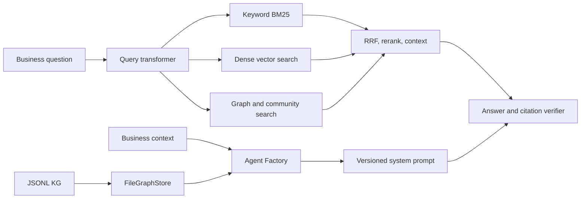

# kg-agent

`kg-agent` is an isolated local-first business Q&A package that reads a knowledge graph and its source text. It sits alongside Paper Trail and does not change Paper Trail's runtime.

## Architecture



## Setup

Python 3.11 or newer is required.

```powershell
python -m venv .venv-kg
.\.venv-kg\Scripts\Activate.ps1
python -m pip install -e ".[dev,api]"
ollama pull qwen2.5:7b-instruct
ollama pull nomic-embed-text
```

Copy `kg-agent.env.example` to `.env` and edit settings as needed. Ollama is the default and keeps prompts and graph evidence local. For OpenRouter, set `LLM_PROVIDER=openrouter`, set `LLM_MODEL` to a current free model ID, and provide `OPENROUTER_API_KEY`. No provider key is stored in source.

Run entirely offline with deterministic behavior and the included sample graph:

```powershell
python -m kg_agent.cli build-agent
python -m kg_agent.cli ask "Which supplier issued invoice-PT-2026001?" --mode agent --no-llm --verbose
```

Build the optional local embedding index after Ollama is available:

```powershell
python -m kg_agent.cli index
```

Compare retrieval modes against the 20 labeled sample questions:

```powershell
python -m kg_agent.cli eval --no-llm
```

The report is written to `runs/eval_report.md`. Its README table reports recall@k, answer token overlap, citation-ID validity, latency, and average LLM calls. The synthetic sample metrics are development checks, not invoice extraction accuracy or semantic faithfulness claims.

Run an interactive chat or local API:

```powershell
python -m kg_agent.cli chat --mode agent
python -m kg_agent.cli serve --host 127.0.0.1 --port 8000
```

The API provides `GET /schema`, `POST /ask` (`question`, `mode`, optional `history`), and `GET /trace/{id}`. Traces are also saved as JSON under `runs/`.

## Data layout

- `data/sample/{nodes,edges,chunks}.jsonl`: synthetic procurement KG used for tests and demos (40 nodes, 60 edges, 30 chunks).
- `config/business_context.yaml`: audience, glossary, KPIs, and example guidance for the Agent Factory.
- `artifacts/system_prompt.vN.md` plus a JSON metadata sidecar: generated schema-specific prompt versions.
- `data/index/dense.json`: local embedding index; generated only when `kg-agent index` is run.

## Current limits

The sample evaluation uses synthetic data. The basic verifier checks citation IDs and retrieval coverage; it does not yet provide semantic claim entailment. Global community summaries are deterministic descriptions, and the optional Neo4j backend and validated read-only Cypher mode are not implemented yet. Dense retrieval needs Ollama embeddings or the optional sentence-transformers fallback.
